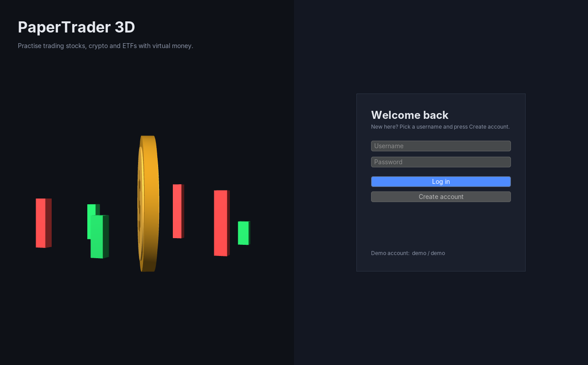
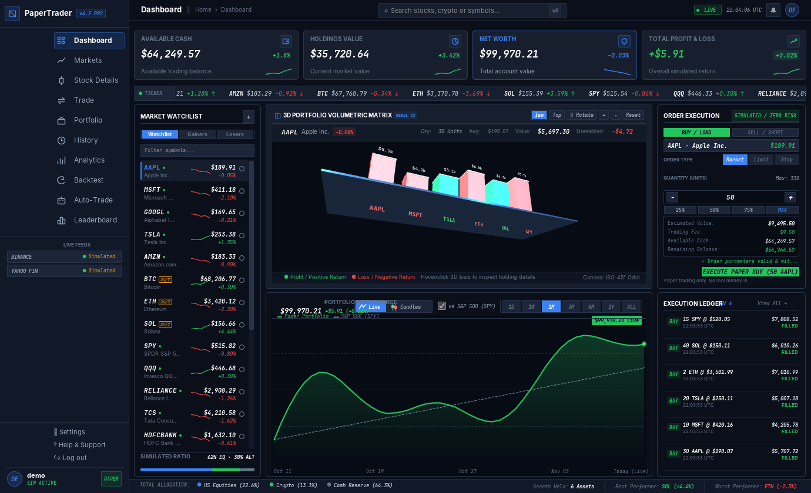
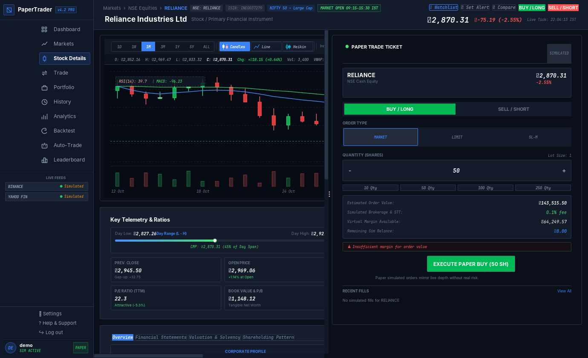
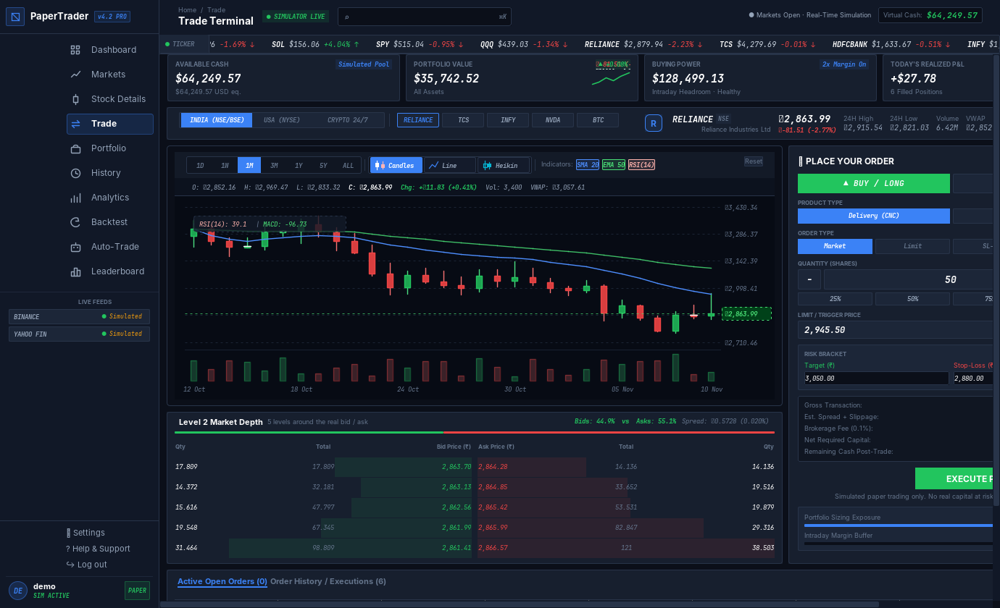
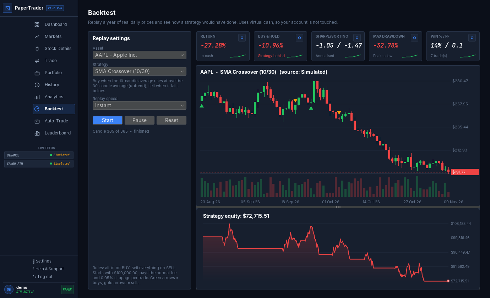
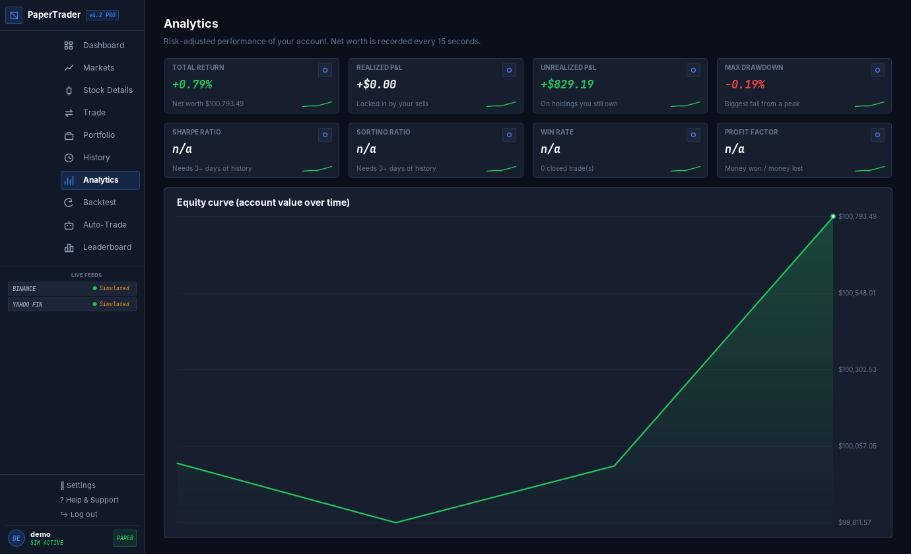
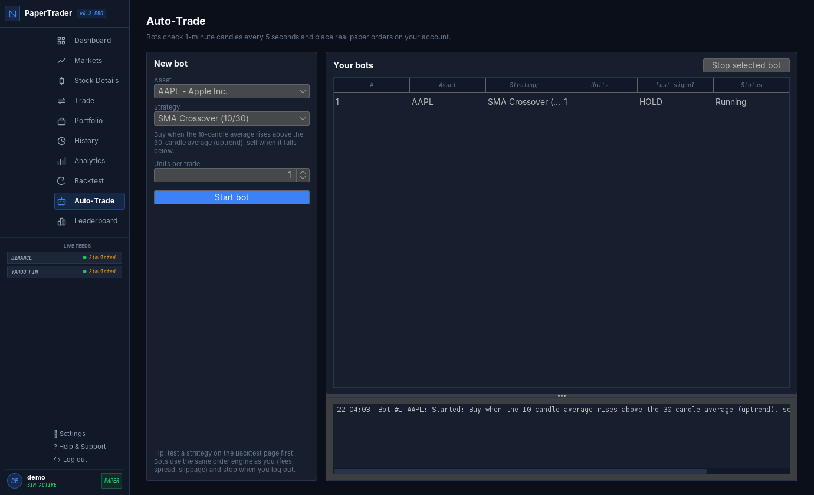
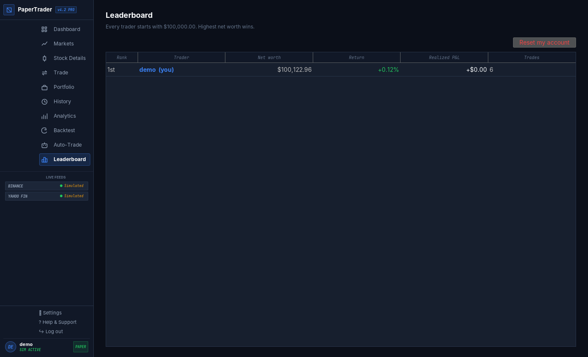

# PaperTrader 3D: Finance Paper Trading Simulator

A Java desktop app for practising trading **stocks, crypto and ETFs** with virtual money.
It uses **real live market prices** (Binance for crypto, Finnhub / Yahoo Finance for stocks and ETFs),
with Market / Limit / Stop-Loss / Take-Profit orders, realistic fills (bid/ask spread + slippage),
candlestick charts, an order book, **backtesting with historical replay**, **risk analytics**
(Sharpe, Sortino, max drawdown, win rate, profit factor), **auto-trading bots**, a **leaderboard**, and **3D visuals**
(a JavaFX 3D portfolio chart you can rotate and a spinning 3D coin on the login screen).

Built as an OOP / Software Engineering project: four OOP pillars, interfaces, SOLID, high cohesion
and low coupling, an SRS using **FODA**, 4 UML diagrams, and the **Spiral** SDLC model.

| Login (3D coin) | Dashboard (3D portfolio) |
|---|---|
|  |  |
| **Stock Details (real candlesticks + indicators)** | **Trade terminal (4 order types + order book)** |
|  |  |
| **Backtest (historical replay 1x/2x/5x)** | **Analytics (risk metrics + equity curve)** |
|  |  |
| **Auto-Trade (strategy bots)** | **Leaderboard** |
|  |  |

## Features

| Area | What you get |
|---|---|
| Orders | Market, Limit, Stop-Loss (SL-M), Take-Profit (TP). Waiting orders execute automatically on price updates. |
| Realistic fills | Buy at the **ask**, sell at the **bid** (spread depends on asset type), plus random **slippage** and **market impact** for big orders. Limit orders never fill worse than their limit. 0.1% brokerage fee. |
| Portfolio | Cash, holdings value, net worth, **realized P&L** (locked in by sells) and **unrealized P&L**, average entry price per position. |
| Market data | Real live prices (Binance, Finnhub / Yahoo Finance) with offline simulation fallback. |
| Charts | Candlestick / line / Heikin-Ashi chart built from **real price history** (Binance, Yahoo Finance; NSE stocks via `.NS`). Ranges 1D / 1W / 1M / 3M / 1Y / 5Y / ALL use 5-minute, 1-hour, daily and weekly candles. SMA 20, EMA 50, real RSI(14), MACD and VWAP. Live prices keep the newest candle moving. |
| Order book | Level 2 **market depth**: 5 bid and 5 ask levels built around the real bid/ask, with the spread and bid/ask ratio. |
| Backtesting | Replay a year of **real daily candles** at **1x / 2x / 5x** or instantly. Strategies: SMA crossover, RSI, Buy & Hold, or your own price rule. Buy/sell arrows on the chart, equity curve, and comparison to buy & hold. |
| Risk analytics | **Sharpe, Sortino, max drawdown, win rate, profit factor**, total return and an equity curve, both for your account and for every backtest. |
| Auto-trading | Start **bots** that follow a strategy or a custom IF/THEN price rule and place real paper orders, with a live activity log. |
| Multi-user | Register / log in, **leaderboard** ranking all traders by net worth, **reset account** to start over. |
| 3D | Rotatable JavaFX 3D portfolio chart, spinning 3D coin on the login screen. |

## Run it

Requirements: **Java 17+** and **Maven** (IntelliJ IDEA / Eclipse / VS Code can also open `pom.xml` directly).

```bash
mvn compile exec:java          # start the app
mvn test                       # run the 58 unit tests
mvn package                    # build target/paper-trading-simulator-1.0.0.jar
java -jar target/paper-trading-simulator-1.0.0.jar
```

Log in with **demo / demo** (created on first run with some sample holdings), or create your own account.

## Real market data

| Assets | Source | Key needed? | Refresh |
|---|---|---|---|
| Crypto (BTC, ETH, SOL) | **Binance**: the exchange's own last traded price (USDT ≈ USD) | No | every 3 s |
| Stocks & ETFs (AAPL, MSFT, GOOGL, TSLA, AMZN, SPY, QQQ) | **Finnhub**: official real-time US exchange quotes | Free key | every 15 s |
| Stocks & ETFs (when no Finnhub key) | **Yahoo Finance** | No | every 15 s |

It works without any setup (Binance + Yahoo). For the most accurate stock prices, add a free Finnhub key:

1. Get a key at <https://finnhub.io/register>.
2. Copy `config.example.properties` to `config.properties` and set `finnhub.apiKey=YOUR_KEY`
   (or set the environment variable `FINNHUB_API_KEY`). `config.properties` is git-ignored.

The sidebar shows each source's status, e.g. `Binance: live 16:30:05`. "Change %" is measured from the previous close
(24 h ago for crypto). US stocks only move during US market hours (about 8:00 PM–2:30 AM IST), and crypto moves 24/7.
With no internet, the app uses simulated prices automatically. You can also force that with `data.mode=simulated`.

The console-only prototype (no UI) shows the engine works on its own:
```bash
mvn compile exec:java -Dexec.mainClass=com.papertrader.ConsoleDemo
```

> If the 3D panels show "3D is not supported by this graphics driver", run with
> `mvn compile exec:java -Dprism.forceGPU=true` (some laptop drivers are blocked by JavaFX by default).
> Everything else works without 3D.

## Libraries (pulled in automatically by Maven)
| Library | Used for |
|---|---|
| Java Swing (built-in) | All screens, tables, forms |
| FlatLaf 3.4 | Modern dark look-and-feel for Swing |
| JavaFX 21 (`javafx-controls`, `javafx-swing`) | 3D views, embedded in Swing with `JFXPanel` |
| org.json | Reading the JSON answers from the market data APIs |
| JUnit 5 | Unit tests |

## Project structure
```
src/main/java/com/papertrader/
├── App.java                 entry point + wiring (composition root)
├── ConsoleDemo.java         spiral loop-1 console prototype
├── model/                   Asset ← Stock, Crypto, ETF
│                            Order ← MarketOrder, LimitOrder, StopLossOrder, TakeProfitOrder
│                            Candle, Timeframe, TradeMarker
├── execution/               ExecutionModel ← RealisticExecutionModel (spread + slippage), PerfectExecutionModel;
│                            OrderBookSimulator
├── strategy/                TradingStrategy ← SmaCrossover, Rsi, BuyAndHold, PriceRule; Indicators
├── backtest/                BacktestEngine (step-by-step historical replay)
├── analytics/               PerformanceAnalyzer (Sharpe, Sortino, drawdown, win rate, profit factor)
├── bot/                     TradingBot, BotService (auto-trading)
│                            User, Account, Portfolio, Holding, Transaction, enums
├── interfaces/              PriceFeed, PriceListener, QuoteProvider, HistoryProvider, FeeCalculator, EquityRepository,
│                            Repository<T,ID>, TransactionRepository, Exportable
├── feed/                    LivePriceFeed (real prices) + Binance/Finnhub/Yahoo QuoteProviders,
│                            SimulatedPriceFeed (offline random-walk prices)
├── fees/                    PercentageFeeCalculator, FlatFeeCalculator
├── repository/              InMemory… and File… repositories (CSV in data/)
├── service/                 AuthService, MarketService, TradingService, PortfolioService, ChartService,
│                            AnalyticsService, LeaderboardService, AppContext
├── exception/               SimulatorException ← InsufficientFunds, InvalidOrder, Auth
├── util/                    Formatter, PasswordHasher, CsvExporter, AppConfig
└── ui/                      MainFrame, LoginPanel, BasePanel ← Dashboard/Market/Trade/
    ├── components/          Portfolio/History/Analytics/Backtest/AutoTrade/Leaderboard panels;
    │                        StatCard, LineChartPanel, CandleChartPanel, OrderBookPanel, StrategyPicker, TickerPanel, renderers
    └── three/               Base3DView ← Coin3DView, Portfolio3DView (JavaFX 3D)
src/test/java/com/papertrader/   58 JUnit tests
docs/
├── SRS.md                   Software Requirements Specification (FODA)
├── SpiralModel.md           SDLC: 4 spiral loops
├── OOP-SOLID-Mapping.md     viva cheat sheet: every concept → file
├── uml/                     class, use-case, sequence, component diagrams (+ FODA feature model)
│                            .puml sources and rendered .png
└── screenshots/
```

## Documentation
- [SRS (FODA method)](docs/SRS.md)
- [Spiral model phases](docs/SpiralModel.md)
- [OOP / SOLID / cohesion-coupling mapping (viva cheat sheet)](docs/OOP-SOLID-Mapping.md)
- UML: [Class](docs/uml/class-diagram.png) · [Use case](docs/uml/use-case-diagram.png) · [Sequence](docs/uml/sequence-diagram.png) · [Component](docs/uml/component-diagram.png) · [FODA feature model](docs/uml/feature-model.png)

To re-render a diagram after editing its `.puml` file, use the PlantUML plugin in IntelliJ / VS Code,
or `java -jar plantuml.jar docs/uml/*.puml`.
