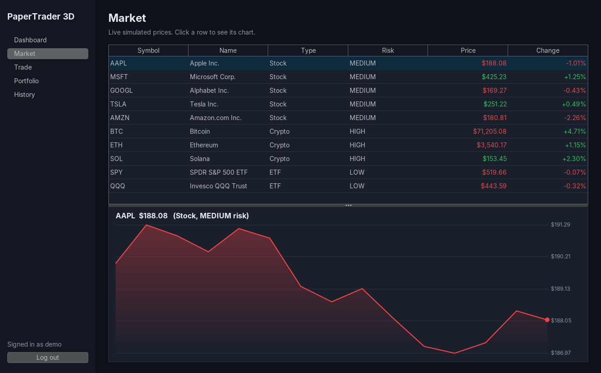
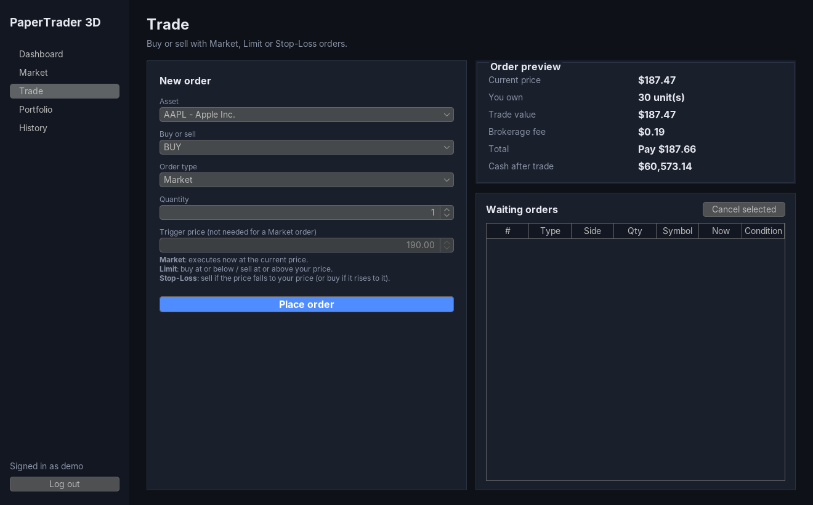

# PaperTrader 3D: Finance Paper Trading Simulator

A Java desktop app for practising trading **stocks, crypto and ETFs** with virtual money.
It has live simulated prices, Market / Limit / Stop-Loss orders, portfolio P&L, and **3D visuals**
(a JavaFX 3D portfolio chart you can rotate and a spinning 3D coin on the login screen).

Built as an OOP / Software Engineering project: four OOP pillars, interfaces, SOLID, high cohesion
and low coupling, an SRS using **FODA**, 4 UML diagrams, and the **Spiral** SDLC model.

| Login (3D coin) | Dashboard (3D portfolio) |
|---|---|
|  |  |
| **Market (live prices + chart)** | **Trade (order form + preview)** |
|  |  |

## Run it

Requirements: **Java 17+** and **Maven** (IntelliJ IDEA / Eclipse / VS Code can also open `pom.xml` directly).

```bash
mvn compile exec:java          # start the app
mvn test                       # run the 26 unit tests
mvn package                    # build target/paper-trading-simulator-1.0.0.jar
java -jar target/paper-trading-simulator-1.0.0.jar
```

Log in with **demo / demo** (created on first run with some sample holdings), or create your own account.

The console-only prototype (no UI) shows the engine works on its own:
```bash
mvn compile exec:java -Dexec.mainClass=com.papertrader.ConsoleDemo
```

> If the 3D panels show "3D is not supported by this graphics driver", run with
> `mvn compile exec:java -Dprism.forceGPU=true` (some laptop drivers are blocked by JavaFX by default).
> Everything else works without 3D.

## Libraries (pulled in automatically by Maven)
| Library | Used for |
|---|---|
| Java Swing (built-in) | All screens, tables, forms |
| FlatLaf 3.4 | Modern dark look-and-feel for Swing |
| JavaFX 21 (`javafx-controls`, `javafx-swing`) | 3D views, embedded in Swing with `JFXPanel` |
| JUnit 5 | Unit tests |

## Project structure
```
src/main/java/com/papertrader/
├── App.java                 entry point + wiring (composition root)
├── ConsoleDemo.java         spiral loop-1 console prototype
├── model/                   Asset ← Stock, Crypto, ETF
│                            Order ← MarketOrder, LimitOrder, StopLossOrder
│                            User, Account, Portfolio, Holding, Transaction, enums
├── interfaces/              PriceFeed, PriceListener, FeeCalculator,
│                            Repository<T,ID>, TransactionRepository, Exportable
├── feed/                    SimulatedPriceFeed (random-walk prices every second)
├── fees/                    PercentageFeeCalculator, FlatFeeCalculator
├── repository/              InMemory… and File… repositories (CSV in data/)
├── service/                 AuthService, MarketService, TradingService, PortfolioService
├── exception/               SimulatorException ← InsufficientFunds, InvalidOrder, Auth
├── util/                    Formatter, PasswordHasher, CsvExporter
└── ui/                      MainFrame, LoginPanel, BasePanel ← Dashboard/Market/Trade/
    ├── components/          Portfolio/History panels; StatCard, LineChartPanel, TickerPanel, renderers
    └── three/               Base3DView ← Coin3DView, Portfolio3DView (JavaFX 3D)
src/test/java/com/papertrader/   26 JUnit tests
docs/
├── SRS.md                   Software Requirements Specification (FODA)
├── SpiralModel.md           SDLC: 4 spiral loops
├── OOP-SOLID-Mapping.md     viva cheat sheet: every concept → file
├── uml/                     class, use-case, sequence, component diagrams (+ FODA feature model)
│                            .puml sources and rendered .png
└── screenshots/
```

## Documentation
- [SRS (FODA method)](docs/SRS.md)
- [Spiral model phases](docs/SpiralModel.md)
- [OOP / SOLID / cohesion-coupling mapping (viva cheat sheet)](docs/OOP-SOLID-Mapping.md)
- UML: [Class](docs/uml/class-diagram.png) · [Use case](docs/uml/use-case-diagram.png) · [Sequence](docs/uml/sequence-diagram.png) · [Component](docs/uml/component-diagram.png) · [FODA feature model](docs/uml/feature-model.png)

To re-render a diagram after editing its `.puml` file, use the PlantUML plugin in IntelliJ / VS Code,
or `java -jar plantuml.jar docs/uml/*.puml`.
