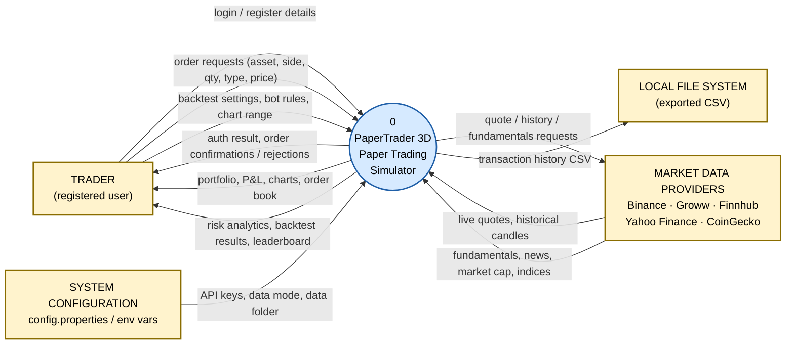
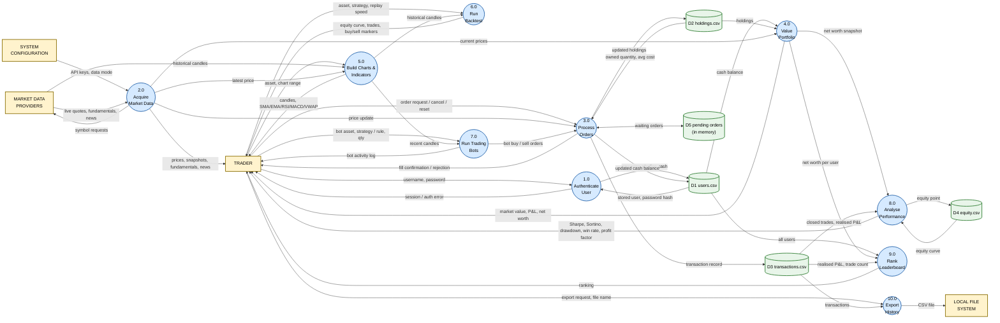
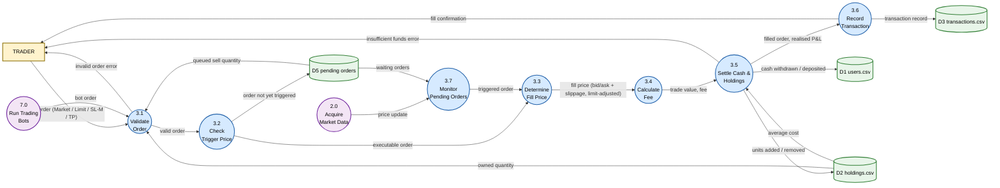

# Data Flow Diagrams (DFD)

These diagrams show how data moves through PaperTrader 3D: who sends data in, what each process does with it,
and where it is stored. They are drawn from the real code (`App.java` wiring, the `service/`, `feed/`,
`backtest/`, `bot/`, `analytics/` and `repository/` packages).

**Notation** (Yourdon/DeMarco style)

| Symbol | Meaning |
|---|---|
| Yellow rectangle | External entity (outside the system) |
| Blue circle | Process |
| Green cylinder | Data store |
| Labelled arrow | Data flow |

The GitHub view below renders the Mermaid source directly. Static images are in [`docs/diagrams/`](diagrams/)
(PNG and SVG), and the sources are in [`docs/diagrams/src/`](diagrams/src/).

## Level 0: Context diagram

The whole simulator is one process. It talks to the trader, the live market data APIs, the configuration
(API keys, data mode) and the local file system (CSV export).

PNG: [dfd-level0.png](diagrams/dfd-level0.png) · SVG: [dfd-level0.svg](diagrams/dfd-level0.svg)

## Level 1: Main processes

| # | Process | Main classes |
|---|---|---|
| 1.0 | Authenticate User | `AuthService`, `PasswordHasher`, `FileUserRepository` |
| 2.0 | Acquire Market Data | `LivePriceFeed` / `SimulatedPriceFeed`, `*QuoteProvider`, `MarketService`, `MarketDataService` |
| 3.0 | Process Orders | `TradingService`, `ExecutionModel`, `FeeCalculator`, `Order` subclasses |
| 4.0 | Value Portfolio | `PortfolioService`, `Portfolio`, `Holding`, `Account` |
| 5.0 | Build Charts & Indicators | `ChartService`, `HistoryProvider`s, `TechnicalAnalysis`, `Indicators` |
| 6.0 | Run Backtest | `BacktestEngine`, `TradingStrategy` implementations |
| 7.0 | Run Trading Bots | `BotService`, `TradingBot` |
| 8.0 | Analyse Performance | `AnalyticsService`, `PerformanceAnalyzer`, `TradeStats`, `FileEquityRepository` |
| 9.0 | Rank Leaderboard | `LeaderboardService` |
| 10.0 | Export History | `CsvExporter` (from the History page) |

| Store | Contents | Class |
|---|---|---|
| D1 `users.csv` | username, password hash, cash balance | `FileUserRepository` |
| D2 `holdings.csv` | username, symbol, quantity, average cost | `FileUserRepository` |
| D3 `transactions.csv` | append-only trade ledger | `FileTransactionRepository` |
| D4 `equity.csv` | net-worth snapshots over time | `FileEquityRepository` |
| D5 pending orders | Limit / Stop-Loss / Take-Profit orders waiting for their price (in memory) | `TradingService.pendingOrders` |

PNG: [dfd-level1.png](diagrams/dfd-level1.png) · SVG: [dfd-level1.svg](diagrams/dfd-level1.svg)

## Level 2: Process 3.0 Process Orders

Process 3.0 is the core of the simulator, so it is exploded one level further. It follows
`TradingService.placeOrder()`, `execute()` and `onPriceUpdate()`.

- **3.1 Validate Order**: a sell can't exceed owned units minus units already queued for sale.
- **3.2 Check Trigger Price**: `Order.canExecute(price)` (runtime polymorphism over Market / Limit / SL-M / TP). Not yet triggered orders go to D5.
- **3.3 Determine Fill Price**: `ExecutionModel.getFillPrice()` (bid/ask spread + slippage), then `Order.adjustFillPrice()` so a limit order never fills worse than its limit.
- **3.4 Calculate Fee**: `FeeCalculator.calculateFee()` (0.1% by default).
- **3.5 Settle Cash & Holdings**: `Account.withdraw/deposit`, `Portfolio.addUnits/removeUnits`, realised P&L from average cost.
- **3.6 Record Transaction**: `TransactionRepository.save()`.
- **3.7 Monitor Pending Orders**: on every price update (Observer pattern) waiting orders are re-checked and filled.

PNG: [dfd-level2-orders.png](diagrams/dfd-level2-orders.png) · SVG: [dfd-level2-orders.svg](diagrams/dfd-level2-orders.svg)

## Balancing check

Every flow on the Level 0 diagram appears on Level 1: trader inputs go to 1.0, 3.0, 5.0, 6.0, 7.0 and 10.0;
provider data enters through 2.0 and 5.0; configuration enters through 2.0; the CSV leaves through 10.0.
Level 2 keeps the same inputs and outputs as process 3.0 on Level 1 (order request, bot orders, price update,
D1/D2/D3/D5, confirmation or rejection).
