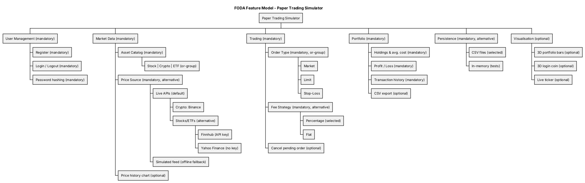

# Software Requirements Specification (SRS)
## Finance Paper Trading Simulator ("PaperTrader 3D")

| Item | Value |
|---|---|
| Version | 1.0 |
| Requirements method | **FODA (Feature-Oriented Domain Analysis)** |
| SDLC model | Spiral model (see [SpiralModel.md](SpiralModel.md)) |
| Structure | IEEE 830 style |

---

## 1. Introduction

### 1.1 Purpose
This document describes what the Finance Paper Trading Simulator must do. It is written for the
project team, the evaluator and anyone who maintains the code later.

### 1.2 Scope
PaperTrader 3D is a Java desktop application that lets a user practise buying and selling
stocks, cryptocurrencies and ETFs with **virtual money** at live market prices. The user can
place Market, Limit and Stop-Loss orders, track profit and loss, and view their portfolio as a
rotatable 3D bar chart. Prices are **real market prices** (Binance for crypto, Finnhub or Yahoo
Finance for stocks and ETFs), with a simulated mode for offline use. No real money and no real
orders are involved.

### 1.3 Definitions
| Term | Meaning |
|---|---|
| Paper trading | Simulated trading with fake money |
| Asset | Anything that can be traded: Stock, Crypto or ETF |
| Market order | Executes immediately at the current price |
| Limit order | Executes only at a chosen price or better |
| Stop-loss order | Executes when the price crosses a chosen "stop" price |
| Holding | Units of one asset owned by a user, with average cost |
| P&L | Profit and loss |
| Tick | One price update of the simulator (every 1 second) |
| FODA | Feature-Oriented Domain Analysis, a requirements method that models a domain as features |

### 1.4 References
- IEEE Std 830-1998, Recommended Practice for Software Requirements Specifications
- Kang et al., *Feature-Oriented Domain Analysis (FODA) Feasibility Study*, SEI, 1990
- Boehm, *A Spiral Model of Software Development and Enhancement*, 1988

### 1.5 Overview
Section 2 describes the product in general. Section 3 is the FODA domain analysis (context,
feature model and operational model). Section 4 lists the specific requirements. Section 5 links
the requirements to the UML diagrams.

---

## 2. Overall Description

### 2.1 Product perspective
A stand-alone desktop application. It reads live prices from public market data APIs over the
internet; without internet it switches to simulated prices. Data is stored in CSV files in a
`data/` folder next to the app.

### 2.2 Product functions (summary)
1. Register, log in, log out
2. View live real market prices (simulated when offline) and a price chart per asset
3. Place Market, Limit and Stop-Loss orders (buy and sell)
4. Preview the fee and total before trading
5. Automatically execute waiting orders when their price condition is met
6. Cancel a waiting order
7. View portfolio holdings with live value and P&L
8. View transaction history and export it to CSV
9. View a 3D bar chart of the portfolio and a 3D animated login screen

### 2.3 User classes
| User | Description |
|---|---|
| Guest | Not logged in. Can register or log in. |
| Trader | Logged-in user. Can use every trading feature. |
| Market Data Feed (system actor) | The live APIs (or the offline simulator) that update prices. |

### 2.4 Operating environment
- Java 17 or newer, Windows / macOS / Linux
- A graphics card that supports JavaFX 3D (almost all do). Without it, the app still runs and shows a message in place of the 3D views.

### 2.5 Design and implementation constraints
- Backend and UI in **Java** (team has been taught Java). UI: **Swing** with FlatLaf theme; 3D: **JavaFX 3D** embedded with `JFXPanel`.
- Must demonstrate the OOP pillars, interfaces, SOLID principles, high cohesion and low coupling.
- Code must be simple enough to explain in a viva.

### 2.6 Assumptions and dependencies
- Live prices come from third-party APIs; their accuracy and availability are outside our control. US stocks only move during US market hours (about 8:00 PM to 2:30 AM IST); crypto moves 24/7.
- Prices are shown in US dollars (crypto in USDT, a dollar-pegged coin).
- Quantities are whole units.
- Only one user is logged in at a time on one computer.

---

## 3. Domain Analysis using FODA

FODA has three phases: **Context Analysis**, **Domain Modelling** (feature model, entity
relationships, functional model) and **Architecture Modelling**.

### 3.1 Context analysis
**Domain:** retail securities trading for learners.
**Domain scope:** account management, market data, order management, portfolio accounting,
visualisation. Out of scope: real brokers, real orders, real payments, margin, short selling, options.

Context diagram (data flows):
```
             register / login / orders               live quotes (HTTPS/JSON)
  [Trader] ----------------------------> [ PaperTrader 3D ] <-------------- [Binance, Finnhub /
                                                                              Yahoo Finance]
           <----------------------------           |
              dashboards, P&L, 3D charts           v
                                              [ data/*.csv ]
```

### 3.2 Feature model


Feature types used (FODA notation):

| Feature | Type | Notes |
|---|---|---|
| User Management | Mandatory | Register, Login/Logout, Password hashing |
| Market Data | Mandatory | |
| Asset Catalog: Stock / Crypto / ETF | Mandatory, **or-group** | At least one; all three implemented |
| Price Source | Mandatory, **alternative** (exactly one) | Live APIs (default) or Simulated feed (offline) |
| Stock/ETF quote provider | Mandatory under Live, **alternative** | Finnhub (with free key) or Yahoo Finance (no key) |
| Crypto quote provider | Mandatory under Live | Binance |
| Price history chart | Optional | |
| Order Type: Market / Limit / Stop-Loss | Mandatory, **or-group** | All three implemented |
| Fee Strategy | Mandatory, **alternative** | Percentage (selected) or Flat |
| Cancel pending order | Optional | |
| Portfolio: holdings, P&L, history | Mandatory | |
| CSV export | Optional | |
| Persistence | Mandatory, **alternative** | CSV files (app) or in-memory (tests) |
| Visualisation: 3D bars, 3D coin, live ticker | Optional | |

**Composition rules** (constraints between features):
- *Limit* and *Stop-Loss* **require** *Price Source* (they wait for price ticks).
- *Profit/Loss* **requires** *Market Data*.
- *3D portfolio bars* **requires** *Holdings*.
- *CSV export* **requires** *Transaction history*.

**Binding time:** Fee strategy, Price source and Persistence are bound at *start-up* in `App.java`.
Price source and quote provider are chosen from `config.properties` / environment variables
(`data.mode`, `finnhub.apiKey`), and the app falls back to Simulated automatically if no API answers. Order type and Asset are bound at *run-time* by the user.

**How features map to code:** an *alternative* feature becomes an **interface** with one class per
alternative (`FeeCalculator` → `PercentageFeeCalculator` / `FlatFeeCalculator`; `PriceFeed` →
`LivePriceFeed` / `SimulatedPriceFeed`; `QuoteProvider` → `BinanceQuoteProvider` /
`FinnhubQuoteProvider` / `YahooQuoteProvider`; `Repository` → `File…` / `InMemory…`). An *or-group* becomes an
**abstract class** with subclasses (`Order` → `MarketOrder` / `LimitOrder` / `StopLossOrder`;
`Asset` → `Stock` / `Crypto` / `ETF`).

### 3.3 Entity-relationship model
- A **User** has exactly one **Account** (cash) and one **Portfolio**.
- A **Portfolio** has zero or more **Holdings** (one per asset symbol).
- An **Order** refers to one **Asset** and has a side (BUY/SELL) and status.
- A filled Order produces one **Transaction**.

See the class diagram: [uml/class-diagram.png](uml/class-diagram.png).

### 3.4 Functional (operational) model
The main behaviour is "place an order" (see [uml/sequence-diagram.png](uml/sequence-diagram.png)):
1. Trader fills the order form. 2. The system creates the right `Order` subclass.
3. `canExecute(price)` decides: fill now, or wait. 4. On fill: fee is calculated, cash and holdings
are updated, a transaction is recorded and saved. 5. Waiting orders are re-checked on every tick.

Order state machine: `PENDING → FILLED`, `PENDING → CANCELLED` (by user),
`PENDING → REJECTED` (not enough cash or units when the condition is finally met).

### 3.5 Architecture model
Layered architecture: **Presentation** (Swing + JavaFX) → **Service** → **Domain Model**, with
**Infrastructure** (price feed, fee calculators, file repositories) plugged in through interfaces.
See [uml/component-diagram.png](uml/component-diagram.png).

---

## 4. Specific Requirements

### 4.1 Functional requirements

| ID | Requirement | Priority |
|---|---|---|
| FR-1 | The system shall let a guest register with a username (3–20 letters, digits or `_`) and a password (min 4 chars). | High |
| FR-2 | The system shall reject a username that already exists. | High |
| FR-3 | The system shall give each new user $100,000 virtual cash. | High |
| FR-4 | The system shall log a user in only with the correct password, and store only a SHA-256 hash of the password. | High |
| FR-5 | The system shall offer 10 assets (5 stocks, 3 cryptos, 2 ETFs) with name, type and risk level. | High |
| FR-6 | The system shall use **real market prices** by default: crypto from Binance (refreshed every 3 s), stocks and ETFs from Finnhub when an API key is configured, otherwise Yahoo Finance (refreshed every 15 s). | High |
| FR-6a | The system shall load real prices before the main window opens, so trading starts at market prices. | High |
| FR-6b | The system shall show "change %" against the real previous close (24 h open for crypto). | Medium |
| FR-6c | The system shall show each data source's status (live with last update time, or offline) in the sidebar. | Medium |
| FR-6d | If no market data API is reachable at start-up, or `data.mode=simulated` is set, the system shall use simulated random-walk prices whose size depends on asset type (ETF < Stock < Crypto). | High |
| FR-6e | If an API fails while running, the system shall keep the last known price and retry on the next refresh. | High |
| FR-7 | The system shall show a live price table with change %, flashing green/red on each change. | Medium |
| FR-8 | The system shall show a line chart of the last 90 prices of the selected asset. | Medium |
| FR-9 | The system shall let the trader place a **Market** order that executes immediately. | High |
| FR-10 | The system shall let the trader place a **Limit** order (buy ≤ limit, sell ≥ limit). | High |
| FR-11 | The system shall let the trader place a **Stop-Loss** order (sell ≤ stop, buy ≥ stop). | High |
| FR-12 | The system shall show the trade value, fee, total and cash-after before the order is placed. | Medium |
| FR-13 | The system shall reject a buy that costs more than the available cash. | High |
| FR-14 | The system shall reject a sell of more units than owned (including units already in waiting sell orders). | High |
| FR-15 | The system shall check every waiting order on every price tick and execute it when its condition is met. | High |
| FR-16 | The system shall let the trader cancel a waiting order. | Medium |
| FR-17 | The system shall charge a brokerage fee on every trade (0.1% by default). | Medium |
| FR-18 | The system shall keep holdings with weighted average cost. | High |
| FR-19 | The system shall show cash, holdings value, net worth and total P&L on the dashboard. | High |
| FR-20 | The system shall show a 3D bar chart of holdings (height = value, green = profit, red = loss) that the user can rotate and zoom. | Medium |
| FR-21 | The system shall show a portfolio table with quantity, average cost, price, value, P&L and P&L %. | High |
| FR-22 | The system shall list all transactions, newest first, and export them to CSV. | Medium |
| FR-23 | The system shall save users, holdings and transactions to disk and load them on the next start. | High |
| FR-24 | The system shall create a demo account (`demo` / `demo`) with sample holdings on first run. | Low |

### 4.2 Non-functional requirements

| ID | Category | Requirement |
|---|---|---|
| NFR-1 | Performance | The UI shall refresh within 1 second of a price update and never freeze while waiting for the internet (downloads run on a background thread). |
| NFR-1a | Accuracy | Displayed prices shall match the source exchange/API within one refresh interval (3 s crypto, 15 s stocks). |
| NFR-1b | Rate limits | The app shall stay within free API limits (Finnhub: 60 calls/min; app uses about 28). |
| NFR-4a | Security | API keys shall be read from an environment variable or a git-ignored `config.properties`, never from source code. |
| NFR-2 | Usability | A new user shall be able to place a first trade within 2 minutes without help. |
| NFR-3 | Reliability | Invalid input shall never crash the app; it shall show a clear message. |
| NFR-4 | Security | Passwords shall never be stored in plain text. |
| NFR-5 | Portability | The app shall run on Windows, macOS and Linux with Java 17+. |
| NFR-6 | Maintainability | Adding a new order type, asset type, fee rule or storage method shall not require changing existing service classes (Open/Closed). |
| NFR-7 | Testability | Core logic shall be covered by automated JUnit tests that run without a UI. |
| NFR-8 | Graceful degradation | If 3D is not supported, the app shall still work and show a message instead. |

### 4.3 External interface requirements
- **User interface:** dark theme desktop window, left sidebar with Dashboard, Market, Trade, Portfolio, History, and a Log out button. Login screen with a 3D spinning coin.
- **Software interfaces:** Java 17 SE, Swing, FlatLaf 3.4, JavaFX 21 (controls + swing), org.json, JUnit 5.
- **Communication interfaces (HTTPS, JSON):**
  - Binance `GET /api/v3/ticker/24hr?symbols=[...]` → `lastPrice`, `openPrice`
  - Finnhub `GET /api/v1/quote?symbol=..&token=..` → `c` (current), `pc` (previous close)
  - Yahoo Finance `GET /v8/finance/chart/{symbol}` → `meta.regularMarketPrice`, `meta.chartPreviousClose`
- **Files:** `data/users.csv`, `data/holdings.csv`, `data/transactions.csv`.

---

## 5. Use cases (summary)

Diagram: [uml/use-case-diagram.png](uml/use-case-diagram.png)

**UC-6 Place order**
- *Actor:* Trader. *Pre-condition:* logged in.
- *Main flow:* 1) Trader selects asset, side, type, quantity (and price for Limit/Stop). 2) System shows preview (includes UC-7). 3) Trader clicks Place order. 4) System validates. 5) System fills the order or stores it as waiting. 6) System shows the result.
- *Alternate flows:* 4a) not enough cash → error message. 4b) not enough units → error message.
- *Post-condition:* cash, holdings and history are updated and saved (if filled).

**UC-13 Execute pending orders**
- *Actor:* Market Data Feed. *Trigger:* each price update.
- *Flow:* for each waiting order of that asset, if `canExecute(newPrice)` then execute; if it now fails (e.g. cash spent), mark REJECTED.

---

## 6. Traceability

| Requirement | Class(es) | Test |
|---|---|---|
| FR-1..4 | `AuthService`, `User`, `PasswordHasher` | `AuthServiceTest` |
| FR-6..6e | `LivePriceFeed`, `BinanceQuoteProvider`, `FinnhubQuoteProvider`, `YahooQuoteProvider`, `SimulatedPriceFeed` | `QuoteParsingTest`, `LivePriceFeedTest`, `ConsoleDemo` |
| FR-9..11 | `MarketOrder`, `LimitOrder`, `StopLossOrder` | `OrderTest` |
| FR-13..16 | `TradingService`, `Account` | `TradingServiceTest`, `AccountTest` |
| FR-17 | `FeeCalculator` implementations | `FeeCalculatorTest` |
| FR-18 | `Portfolio`, `Holding` | `PortfolioTest` |
| FR-23 | `FileUserRepository`, `FileTransactionRepository` | `PersistenceTest` |
| FR-20 | `Portfolio3DView` | manual (screenshot) |
