# Structure Chart

The structure chart shows the **module hierarchy** of PaperTrader 3D: which module calls which, and what
data and control information passes between them. It is drawn from the actual call paths in the code,
starting at `App.main` (the composition root).

**Notation**

| Symbol | Meaning |
|---|---|
| Dark blue box | Main / root module |
| Blue box | Module (class method or panel) |
| Grey dashed box | Library module behind an interface (has several implementations, e.g. `QuoteProvider`, `ExecutionModel`, `FeeCalculator`, repositories) |
| Arrow | Call from the upper (calling) module to the lower (called) module |
| ○ name | Data couple |
| ● name | Control flag (e.g. `loaded`, `valid`, `executable`, `Signal`) |
| `down / up` | Text before `/` is passed down to the called module, text after `/` is returned up |

```mermaid
flowchart TB
    classDef main fill:#1f5fa8,stroke:#0d2f57,stroke-width:2px,color:#fff
    classDef mod fill:#d6eaff,stroke:#1f5fa8,stroke-width:1.5px,color:#000
    classDef lib fill:#eeeeee,stroke:#555,stroke-width:1.5px,color:#000,stroke-dasharray: 4 3

    M["App.main<br/>(composition root)"]:::main

    C["AppConfig.load"]:::mod
    PF["createPriceFeed"]:::mod
    W["start<br/>(wire services)"]:::mod
    UI["MainFrame<br/>(page navigation)"]:::mod

    M -- "○ config" --> C
    M -- "○ config, assets / ○ PriceFeed" --> PF
    M -- "○ assets, PriceFeed" --> W
    W -- "○ AppContext" --> UI

    %% price feed branch
    LP["LivePriceFeed.loadInitialPrices"]:::mod
    SF["SimulatedPriceFeed"]:::mod
    QP["QuoteProvider.fetchQuotes<br/>(Binance, Groww, Finnhub, Yahoo)"]:::lib
    PF -- "○ assets, providers / ● loaded" --> LP
    PF -- "● loaded = false / ○ assets" --> SF
    LP -- "○ assets / ○ quotes" --> QP

    %% UI pages
    LG["LoginPanel"]:::mod
    TP["TradePanel"]:::mod
    PP["Portfolio / Dashboard<br/>Panels"]:::mod
    SD["StockDetailsPanel"]:::mod
    BP["BacktestPanel"]:::mod
    AT["AutoTradePanel"]:::mod
    AP["AnalyticsPanel"]:::mod
    LB["LeaderboardPanel"]:::mod
    HP["HistoryPanel"]:::mod

    UI --> LG
    UI --> TP
    UI --> PP
    UI --> SD
    UI --> BP
    UI --> AT
    UI --> AP
    UI --> LB
    UI --> HP

    %% Login
    AU["AuthService.login / register"]:::mod
    PH["PasswordHasher.hash"]:::lib
    UR["UserRepository<br/>findById / save"]:::lib
    LG -- "○ username, password / ○ User, ● authError" --> AU
    AU -- "○ password / ○ hash" --> PH
    AU -- "○ username / ○ User" --> UR

    %% Trading
    PO["TradingService.placeOrder"]:::mod
    VO["validate sell quantity"]:::mod
    CE["Order.canExecute"]:::mod
    EX["execute"]:::mod
    FP["ExecutionModel.getFillPrice"]:::lib
    FE["FeeCalculator.calculateFee"]:::lib
    AC["Account.withdraw / deposit"]:::mod
    PT["Portfolio.addUnits / removeUnits"]:::mod
    TR["TransactionRepository.save"]:::lib
    TP -- "○ User, Order / ○ Order, ● rejected" --> PO
    PO -- "○ User, Order / ● valid" --> VO
    PO -- "○ price / ● executable" --> CE
    PO -- "○ User, Order" --> EX
    EX -- "○ asset, side, qty / ○ fillPrice" --> FP
    EX -- "○ tradeValue / ○ fee" --> FE
    EX -- "○ amount / ● insufficientFunds" --> AC
    EX -- "○ symbol, qty, price" --> PT
    EX -- "○ Transaction" --> TR
    EX -- "○ User" --> UR

    %% Portfolio valuation
    PS["PortfolioService.getNetWorth"]:::mod
    MS["MarketService.findBySymbol"]:::mod
    PP -- "○ User / ○ netWorth, P&L" --> PS
    PS -- "○ symbol / ○ Asset price" --> MS

    %% Charts
    CS["ChartService.getCandles"]:::mod
    HPV["HistoryProvider.fetchCandles"]:::lib
    TA["TechnicalAnalysis /<br/>Indicators"]:::mod
    MDS["MarketDataService<br/>snapshot / fundamentals / news"]:::mod
    SD -- "○ Asset, Timeframe / ○ candles" --> CS
    SD -- "○ candles / ○ SMA, EMA, RSI, MACD" --> TA
    SD -- "○ Asset / ○ snapshot, news" --> MDS
    CS -- "○ Asset, Timeframe, count / ○ candles" --> HPV

    %% Backtest
    BE["BacktestEngine.step / runToEnd"]:::mod
    TS["TradingStrategy.decide"]:::lib
    BP -- "○ Asset, Timeframe / ○ candles" --> CS
    BP -- "○ candles, strategy / ○ equity curve, trades" --> BE
    BE -- "○ candles so far, ● holding / ● Signal" --> TS

    %% Bots
    BS["BotService.runBot"]:::mod
    AT -- "○ TradingBot" --> BS
    BS -- "○ candles / ● Signal" --> TS
    BS -- "○ User, Asset, side, qty" --> PO

    %% Analytics
    AS["AnalyticsService.getReport"]:::mod
    PA["PerformanceAnalyzer.analyze"]:::mod
    AP -- "○ User / ○ PerformanceReport" --> AS
    AS -- "○ equity curve, trade profits / ○ report" --> PA
    AS -- "○ User / ○ netWorth" --> PS

    %% Leaderboard
    LS["LeaderboardService.getRanking"]:::mod
    LB -- "○ ranking" --> LS
    LS -- "○ User / ○ netWorth" --> PS

    %% History / export
    TH["TradingService.getTransactionHistory"]:::mod
    CX["CsvExporter.export"]:::lib
    HP -- "○ User / ○ transactions" --> TH
    HP -- "○ transactions, file" --> CX
```

PNG: [structure-chart.png](diagrams/structure-chart.png) · SVG: [structure-chart.svg](diagrams/structure-chart.svg)

## Reading the chart

- **Startup (afferent branch).** `App.main` loads `AppConfig`, then `createPriceFeed` tries `LivePriceFeed.loadInitialPrices`
  (which calls each `QuoteProvider`). If the `loaded` flag comes back false three times, it falls back to `SimulatedPriceFeed`.
- **Transform centre.** `start` builds every service and hands an `AppContext` to `MainFrame`, which owns the pages.
- **Order execution.** `TradePanel` and `BotService` both call `TradingService.placeOrder`, which validates the order,
  asks `Order.canExecute` and, if it can fill, calls `execute`. `execute` is the most fanned-out module: fill price,
  fee, cash, holdings, transaction ledger and user save.
- **Reused modules (fan-in).** `PortfolioService.getNetWorth` is called by the portfolio pages, analytics and the
  leaderboard; `ChartService.getCandles` by stock details and backtesting; `TradingStrategy.decide` by both the
  backtest engine and the bots. High fan-in on these small, cohesive modules is a sign of good design.
- **Coupling.** Modules mostly pass plain data couples (`User`, `Asset`, `candles`). Control flags are few and local
  (`loaded`, `valid`, `executable`, `Signal`), which keeps coupling low.

Sources: [`docs/diagrams/src/`](diagrams/src/).
